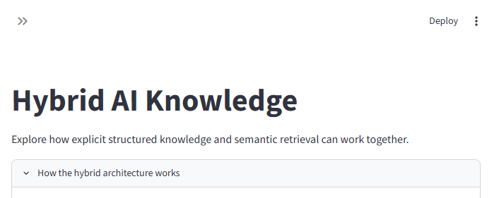
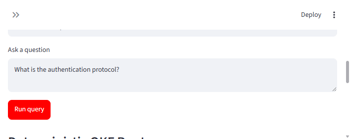
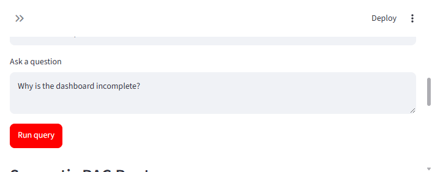

# Hybrid AI Knowledge

An interactive Python learning project demonstrating how deterministic knowledge routing and local semantic retrieval can work together.

## What this teaches

The project has two routes:

- **Deterministic OKF Route:** explicit questions about APIs, protocols, schemas, and rules are answered from Markdown files with metadata.
- **Semantic RAG Route:** conversational or exploratory questions are matched against local notes and logs using TF-IDF vectors and cosine similarity.

The application exposes the route, reason, source file, answer, and similarity score so the decision is inspectable.

## Architecture

```text
User question
         |
         v
    Router
    /   \\
   /     \\
OKF     RAG
route   route
   |       |
Markdown  Local text
metadata  similarity
   |       |
   +--- Answer + evidence ---+
```

The public interface keeps this decision visible so learners can connect the question, route, source, and answer.

## Run locally

From this directory:

```bash
python -m pip install -r requirements.txt
python -m unittest discover -s tests -v
streamlit run app.py
```

The app opens on port `8501`.

## Use GitHub Codespaces

1. Create a new GitHub repository.
2. Upload or push the contents of this `Version2` folder to the repository root.
3. Open the repository on GitHub.
4. Select **Code**, then **Codespaces**, then **Create codespace on main**.
5. Wait for the development container to finish installing dependencies.
6. Open the integrated terminal and run:

   ```bash
   streamlit run app.py
   ```

7. When Codespaces detects port `8501`, select **Open in Browser**.

The `.devcontainer/devcontainer.json` file configures Python, installs the dependencies, forwards port `8501`, and installs the Python editor extensions.

## Try these questions

| Question | Expected route |
| --- | --- |
| What is the authentication protocol? | Deterministic OKF Route |
| What fields are in the user schema? | Deterministic OKF Route |
| Why is the dashboard incomplete? | Semantic RAG Route |
| What changed after the nightly refresh? | Semantic RAG Route |

## Project layout

```text
.
├── app.py
├── hybrid_knowledge.py
├── okf_knowledge/
├── rag_knowledge/
├── tests/
├── requirements.txt
└── .devcontainer/devcontainer.json
```

## Public deployment

Codespaces is a development environment, not permanent public hosting. Once the project works in Codespaces, deploy this repository to Streamlit Community Cloud or Hugging Face Spaces for a public demo.

### Streamlit Community Cloud

1. Push or upload the completed project to a public GitHub repository.
2. Open [share.streamlit.io](https://share.streamlit.io/).
3. Sign in with GitHub and select **New app**.
4. Choose the repository, branch `main`, and file `app.py`.
5. Select **Deploy**.
6. Wait for the dependency installation and app startup.

Streamlit will provide a public URL similar to:

```text
https://your-app-name.streamlit.app
```

The public demo runs from the GitHub repository. When the repository changes, Streamlit can redeploy the app so visitors always use the latest version.

## Screenshots

The repository includes captures from the working local app:







## Learning principle

> Use deterministic logic where correctness matters, and semantic retrieval where discovery matters.

This is an educational prototype, not a production-grade RAG platform.